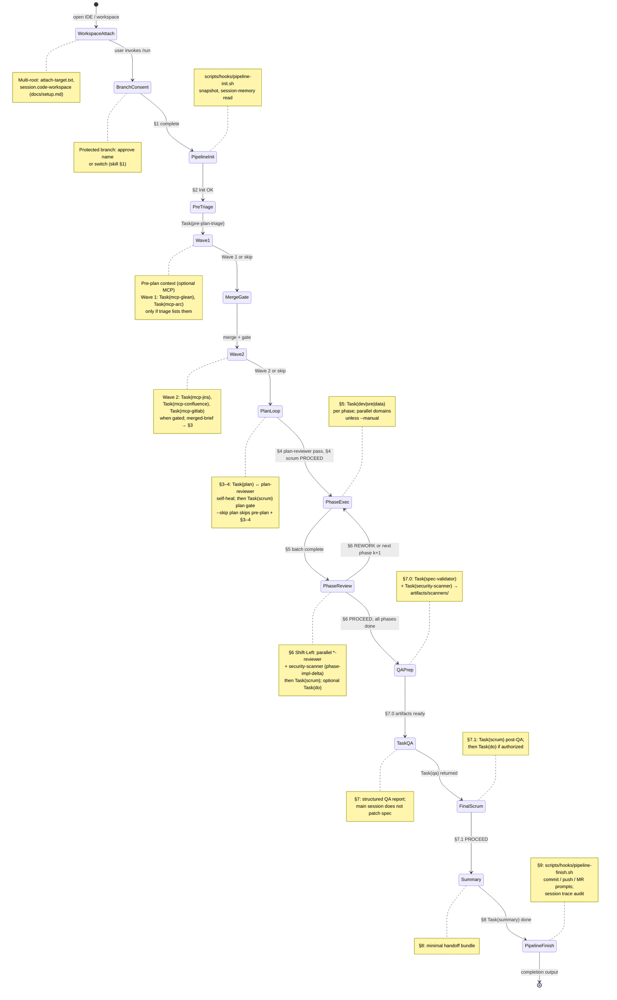
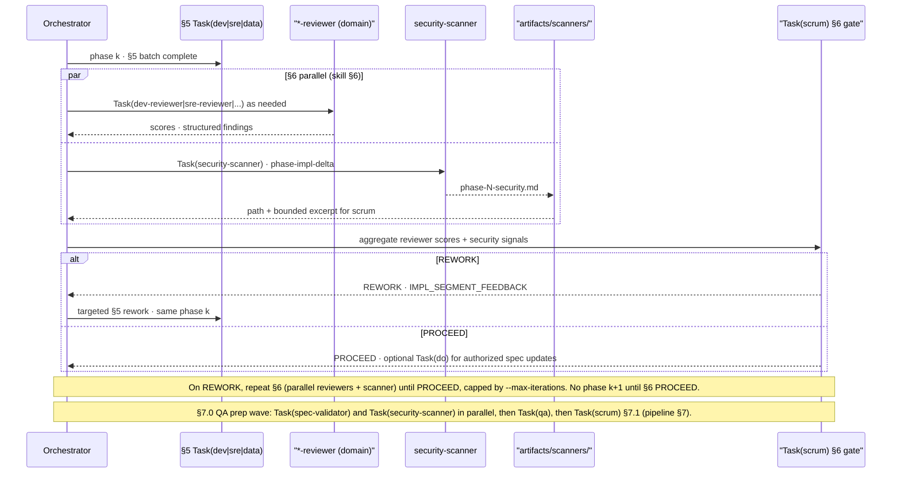

# Agentic Workspace

## Vision and value

The **Agentic Workspace** is a command center for teams that want **spec-aligned delivery** without the failure modes of ad-hoc multi-agent sprawl: runaway context, duplicated work, and nobody sure what shipped. You get a **repeatable pipeline**—plan, implement, review, QA, summary—with human gates, reviewer scores, and bounded session outputs so work stays **traceable, reviewable, and economical on tokens**.

Three ideas sit on top of each other:

- **BMAD** frames *how* work flows: delivery is staged, gated, and owned—not a free-form chat.
- **SDD** (Specification-Driven Development) makes **specs** authoritative: scope, acceptance, and phases live in `docs/specs/` (and related docs), not only in chat history.
- **GSD** (Get Stuff Done) pushes **thin vertical slices**: small, testable changes per gate instead of monolithic “do everything” prompts.

**Flat orchestration** and **least-privilege slices** exist so the system does not recreate **infinite delegation loops** common in unconstrained AI setups—where one agent spawns another, which spawns another, until context explodes and accountability vanishes. Here, **only** the `/run` **main session** schedules `Task(plan)`, `Task(dev)`, readonly specialists, and gates; **personas do not nest** `Task` **on other personas** ([flat orchestration](.cursor/rules/00-workspace-router.mdc)). Implementers receive **least-privilege** work: **one phase**, **one domain** (e.g. dev vs sre), and `WORKTREE_PATHS` when needed—not full merged MCP dumps or whole-session transcripts. Readonly specialists write **bounded** artifacts under `docs/sessions/<id>/`. That structure keeps delegation **finite**, prompts **scoped**, and handoffs **explicit**.

**In one line:** `/run` loads **[run-pipeline](.cursor/skills/run-pipeline/SKILL.md)**: plan → implement → review → QA → summary, with gates and least-privilege artifacts under `docs/sessions/<id>/`.

---


## Table of Contents

- [Vision and value](#vision-and-value)
- [What this is](#what-this-is)
- [Orchestration hub](#orchestration-hub)
- [Pipeline state machine](#pipeline-state-machine)
- [Phase gates and shift-left security](#phase-gates-and-shift-left-security)
- [Session directory anatomy](#session-directory-anatomy)
- [Layered stack](#layered-stack)
- [30-second setup](#30-second-setup)
- [Zero-Trust script API](#zero-trust-script-api)
- [Personas and commands](#personas-and-commands)
- [Pipeline and flags](#pipeline-and-flags)
- [Confidence and specs](#confidence-and-specs)
- [Security and hooks](#security-and-hooks)
- [Session memory and metrics](#session-memory-and-metrics)
- [Troubleshooting and observability](#troubleshooting-and-observability)
- [MCP configuration](#mcp-configuration)
- [Models](#models)
- [Token efficiency](#token-efficiency)
- [Cursor platform reference](#cursor-platform-reference)
- [Rules of engagement](#rules-of-engagement)
- [Extending the workspace](#extending-the-workspace)

---


## What this is

The workspace is a **spec-driven pipeline**: personas (`/plan`, `/dev`, `/qa`, …) and **readonly specialists** (explorers, validators, MCP helpers) coordinated by the **main agent** on `/run`. Escape hatches: `/fix`, `/do` for bugs and ad-hoc ops outside the main pipeline.

Procedure: [run-pipeline skill](.cursor/skills/run-pipeline/SKILL.md) · [human-oriented reference](docs/run-pipeline-reference.md) · [router](.cursor/rules/00-workspace-router.mdc).

---


## Orchestration hub

Readonly specialists run **only** from the **orchestrator** (flat delegation). They write **bounded** output under `docs/sessions/<id>/pre-plan/` (merged MCP) and `docs/sessions/<id>/artifacts/`. Implementers get **least-privilege** slices — phase, one domain, `WORKTREE_PATHS` — not full session dumps.

`Task(do)` applies mechanical edits through the **allowlisted script API** (e.g. `[query-transcript.py](scripts/tools/query-transcript.py)`) after `Task(scrum)` authorizes spec updates. **Finish** uses `[pipeline-finish.sh](scripts/hooks/pipeline-finish.sh)` per [git / GitLab rules](.cursor/rules/git-gitlab-mutations.mdc) and skill **section 9**.

**Law of flat orchestration:** Nested `Task(...)` from personas is **forbidden**; only the orchestrator delegates. Mutations outside normal product work stay on **allowlisted** script and hook paths — [nested-task audit](docs/reference/nested-task-audit.md).

```mermaid
flowchart TD
    MA(["/run main session<br/>Orchestrator hub"])

    subgraph RO["Readonly specialists — only the orchestrator schedules Task(...)"]
        PT[pre-plan-triage]
        W1["Wave 1: Task(mcp-glean) · Task(mcp-arc)"]
        W2["Wave 2: Task(mcp-jira) · Task(mcp-confluence) · Task(mcp-gitlab)"]
        CE[codebase-explorer]
        SV[spec-validator]
        SS[security-scanner]
    end

    subgraph SESS["Bounded paths under docs/sessions/(session-id)/"]
        PP["pre-plan/<br/>merged-brief.md, specialists/…"]
        AR["artifacts/<br/>mcp-briefs/, explorer/, scanners/, diffs/…"]
    end

    subgraph LP["Least-privilege implementers — sliced prompts"]
        IMPL["Task(plan) · Task(dev|sre|data)<br/>one phase · one domain · WORKTREE_PATHS"]
        QA[Task(qa) · Task(summary) · gates]
    end

    subgraph ZT["Zero-trust allowlist — no ad-hoc shell"]
        QTP[query-transcript.py]
        PF[pipeline-finish.sh]
    end

    MA -->|delegates| RO
    MA -->|Task slice| IMPL
    MA -->|Task| QA

    PT & W1 & W2 --> PP
    CE & SV & SS --> AR

    MA -->|"Task(do) after scrum"| QTP
    MA -->|Finish skill 9| PF

    style MA fill:#c0392b,color:#fff
```


---


## Pipeline state machine

**Workspace attach:** multi-root (`attach-target.txt`, `session.code-workspace`, `[attach-project.sh](scripts/tools/attach-project.sh)`) — [setup](docs/setup.md). **§1** branch consent, then `pipeline-init.sh` (**§2**) → **Pre-plan** Wave 1 / Wave 2 MCP (triage + gate, when applicable) → **§3–4** plan loop (`Task(plan)` ↔ `plan-reviewer` ↔ `Task(scrum)`) → **§5** phase execution → **§6** implementation review (Shift-Left: `*-reviewer` + `security-scanner` → `Task(scrum)`; repeat per phase or rework) → **§7.0** QA prep → `Task(qa)` **(§7)** → **§7.1** final `Task(scrum)` → `Task(summary)` **(§8)** → `pipeline-finish.sh` **(§9)**.


| Kind          | Meaning                                                     |
| ------------- | ----------------------------------------------------------- |
| **Human**     | Branch consent, manual gates, Finish commit/push/MR choices |
| **Automated** | Hooks and orchestrator paths without extra confirmation     |





---


## Phase gates and shift-left security

**§6** (per phase, after **§5**) runs `Task(*-reviewer)` and `Task(security-scanner)` in **parallel** — scanner scoped to `phase-impl-delta`, report at `artifacts/scanners/phase-<N>-security.md` — then `Task(scrum)` aggregates scores and security into one gate ([run-pipeline skill](.cursor/skills/run-pipeline/SKILL.md) **§6**). **§7.0** runs a separate **QA prep wave** (`Task(spec-validator)` + `Task(security-scanner)` → `artifacts/scanners/`) before `Task(qa)` and **§7.1** `Task(scrum)` — pipeline **§7**; scrum still uses **PROCEED / REWORK / ASK_USER**. See [run-pipeline reference](docs/run-pipeline-reference.md), [router invalid-completion rules](.cursor/rules/00-workspace-router.mdc).




---


## Session directory anatomy

**Active session pointer:** `docs/sessions/ACTIVE_SESSION` is a **plain-text file** (one line: the `YYYY-MM-DDTHHMMSSZ` session id, optionally suffixed). Scripts resolve `docs/sessions/<session-id>/current.md` from that id — **not** via a symlink to `current.md` ([Session storage](docs/run-pipeline-reference.md#session-storage)).

```text
docs/sessions/
├── ACTIVE_SESSION             # one line: active session id (plain file, not a symlink)
├── README.md                  # optional tracked conventions (parent dir otherwise gitignored)
└── <session-id>/
    ├── current.md             # timeline, GATE lines, trace anchors
    ├── context-audit.log      # Finish audit (append-only)
    ├── attach-target.txt      # optional: multi-root writable repo root
    ├── session.code-workspace # optional: generated multi-root workspace
    ├── pre-plan/
    │   ├── merged-brief.md
    │   └── specialists/       # glean, arc, jira, … + mid-run files
    └── artifacts/
        ├── mcp-briefs/        # scaffold / LPP namespace
        ├── explorer/          # Task(codebase-explorer) reports
        ├── scanners/          # §7.0 spec-validator, security-scanner
        └── diffs/
            ├── dev/
            ├── sre/
            ├── data/
            └── plan/
```

- **no** root-level session clutter — keep `docs/sessions/<session-id>/` to the files and dirs above; put bounded handoffs under `pre-plan/` and `artifacts/` ([run-pipeline skill](.cursor/skills/run-pipeline/SKILL.md) Non-negotiables item 9).
- **no** backward-compatibility **symlinks** under `docs/sessions/<session-id>/` (e.g. legacy alias paths pointing at renamed trees) — **hard cutover** to canonical paths only.

`docs/sessions/` contents (except optional tracked `[README.md](docs/sessions/README.md)`) are **gitignored** — local scratch per clone.

---


## Layered stack


| Layer           | Location                                                                                                          |
| --------------- | ----------------------------------------------------------------------------------------------------------------- |
| Rules           | `[.cursor/rules/*.mdc](.cursor/rules/)`                                                                           |
| Personas        | `[.cursor/agents/](.cursor/agents/)`                                                                              |
| Skills          | `[.cursor/skills/](.cursor/skills/)`                                                                              |
| Scripts / hooks | `[scripts/tools/](scripts/tools/)`, `[scripts/hooks/](scripts/hooks/)` (`pipeline-init.sh`, `pipeline-finish.sh`) |
| IDE hooks       | `[.cursor/hooks.json](.cursor/hooks.json)`, `[.cursor/hooks/](.cursor/hooks/)`                                    |
| MCP             | `[.cursor/mcp.json](.cursor/mcp.json)` (optional)                                                                 |


---


## 30-second setup

- **Framework:** clone this repo, run setup (creates runtime dirs, validates JSON including hooks/MCP when present).
- **Multi-root target:** put app repos under `PROJECTS_ROOT`, run `attach-project.sh` — writes `docs/sessions/<id>/session.code-workspace` and `attach-target.txt` ([setup](docs/setup.md#multi-root-attach-road-48)).
- **Single-folder target:** clone the app under `myapp/` here if you do not use attach (pass `myapp/` to `/run` / agents).
- **Optional MCP:** committed `[.cursor/mcp.json](.cursor/mcp.json)` is the team baseline — adjust URLs / `${env:…}` per [cursor-mcp](docs/reference/cursor-mcp.md); restart Cursor and confirm **Settings → MCP**.

```bash
git clone <repo-url> && cd agentic-workspace
./scripts/setup.sh
```

```bash
export PROJECTS_ROOT="${HOME}/work"
mkdir -p "$PROJECTS_ROOT" && git clone <your-app-repo> "$PROJECTS_ROOT/myapp"
grep -q '^PROJECTS_ROOT=' .env.local 2>/dev/null || printf 'PROJECTS_ROOT=%q\n' "$PROJECTS_ROOT" >> .env.local
./scripts/tools/attach-project.sh
```

```bash
git clone <your-app-repo> myapp/
```

```bash
# optional: after editing .cursor/mcp.json — validates JSON
./scripts/setup.sh
```

- Open `session.code-workspace` from attach, or single-root this repo; then `/run <target>/ "goal"` or `/plan`. Details: [setup](docs/setup.md).

---


## Zero-Trust script API

Orchestration and `Task(do)` call **allowlisted** scripts only—**not** raw arbitrary shell or `python3 -c` / inline one-liners for transcript parsing or other mechanical work (**Zero Trust Shell**).


| Safe entry       | Path                                                                     | Role                                                                             |
| ---------------- | ------------------------------------------------------------------------ | -------------------------------------------------------------------------------- |
| Pipeline init    | `[scripts/hooks/pipeline-init.sh](scripts/hooks/pipeline-init.sh)`       | Session wiring at `/run` init (run-pipeline **§2**).                             |
| Pipeline finish  | `[scripts/hooks/pipeline-finish.sh](scripts/hooks/pipeline-finish.sh)`   | Finish flow, prompts, session trace audit (skill **§9**).                        |
| Transcript query | `[scripts/tools/query-transcript.py](scripts/tools/query-transcript.py)` | Read-only transcript slices for `Task(do)`—no hand-rolled JSONL parsing in chat. |


**Why raw arbitrary shell and inline Python are banned for agents**

- **Bounded, reviewable surface:** Only these paths (and the repo’s other vetted `scripts/` helpers) are maintained, testable, and lintable; one-off `sh -c`, `rg | …`, `awk`**/**`sed` pipelines are not—so they bypass shell encapsulation and are easy for models to get wrong.
- **Inline Python** (`python3 -c`, pasted snippets) sidesteps `query-transcript.py`, hides behavior from `lint-check.sh` sweeps of agent/skills text, and recreates the “rogue parser” problem removed from `Task(do)`.
- **If no script fits:** escalate (`QUESTION:` / extend tooling)—do **not** invent inline code to bridge the gap.

---


## Personas and commands


| Command                | Role                                                                                                                                                                                                                                                                                               |
| ---------------------- | -------------------------------------------------------------------------------------------------------------------------------------------------------------------------------------------------------------------------------------------------------------------------------------------------- |
| `/run`                 | **Orchestrator** — loads [run-pipeline](.cursor/skills/run-pipeline/SKILL.md) in the **main** session; **only** this session schedules `Task(plan)`, implementing personas (`dev` / `sre` / `data`), readonly specialists, and gates ([rule](.cursor/rules/run-pipeline-trigger.mdc)).             |
| `/plan`                | Staff architect — draft or amend specs under `docs/specs/`.                                                                                                                                                                                                                                        |
| `/dev`                 | Software engineer — `[dev]` tasks from a spec; **one phase · one domain** per delegation when orchestrated.                                                                                                                                                                                        |
| `/qa`                  | QA and security — structured review report (spec-validator + security-scanner feeds when applicable).                                                                                                                                                                                              |
| `/scrum`               | Product owner / gate — **PROCEED** / **REWORK** / **ASK_USER** at plan, implementation, and post-QA scrums.                                                                                                                                                                                        |
| `/fix`                 | **Escape hatch** — debugger for a target directory and symptom outside the full pipeline.                                                                                                                                                                                                          |
| `/do`                  | **Escape hatch** — ad-hoc operator; mechanical work uses the [Zero-Trust script API](#zero-trust-script-api) and authorized `Task(do)` paths.                                                                                                                                                      |
| `/sre`, `/data`        | Platform / data engineer — `[sre]` / `[data]` tasks; same slice rules as `/dev`.                                                                                                                                                                                                                   |
| `/summary`, `/kb`      | Summary handoff, local KB build — see skills and [Extending the workspace](#extending-the-workspace).                                                                                                                                                                                              |
| *Readonly specialists* | **Dual-mode:** user `/name` (`/codebase-explorer`, `/spec-validator`, `/security-scanner`, `/pre-plan-triage`, `/mcp-`*, `*-reviewer`) **or** the `/run` main session schedules `Task(...)` — **personas do not** nest `Task` on these ([nested-task audit](docs/reference/nested-task-audit.md)). |


---


## Pipeline and flags

[run-pipeline skill](.cursor/skills/run-pipeline/SKILL.md) defines branch consent, worktrees, `--resume`, `--manual` (step gates, not manual **models**), `--skip`, Finish. `--manual` ≠ optional `.cursor/models.user.yml` models table.


| Flag              | Purpose                                      |
| ----------------- | -------------------------------------------- |
| `--review`        | Pause after major steps                      |
| `--manual`        | Pause after plan and after each domain track |
| `--confidence N`  | Review threshold                             |
| `--skip <step>`   | Skip a named step                            |
| `--resume`        | Continue from session memory                 |
| `--branch [name]` | Suggested branch (you still approve)         |


---


## Confidence and specs

Reviewers score; `/scrum` decides PROCEED / REWORK / ASK_USER. [Confidence skill](.cursor/skills/confidence-scoring/SKILL.md), router. Specs: `docs/specs/` (local; often gitignored) — [generate-spec](.cursor/skills/generate-spec/SKILL.md), [run-pipeline reference](docs/run-pipeline-reference.md) for phases and `[domain:repo]` tags.

---


## Security and hooks

Hooks **fail open** except **subagent-gate** (no writes on protected branches in child repos). [cursor-hooks](docs/reference/cursor-hooks.md), router. `/sre`: [deploy-checklist](.cursor/skills/deploy-checklist/SKILL.md).

---


## Session memory and metrics

`[session-memory.sh](scripts/tools/session-memory.sh)`, `[metrics.sh](scripts/tools/metrics.sh)`. Conventions: [run-pipeline reference](docs/run-pipeline-reference.md), [sessions README](docs/sessions/README.md).

```bash
scripts/tools/session-memory.sh read
scripts/tools/metrics.sh overview
```

---


## Troubleshooting and observability

Use these logs and commands when a run pauses, you need traceability, or you are validating least-privilege orchestration. Authoritative detail: [run-pipeline reference — Local auditing](docs/run-pipeline-reference.md#local-auditing), [run-pipeline reference — Manual step gates](docs/run-pipeline-reference.md#manual-step-gates---manual), [run-pipeline skill — Manual step gates](.cursor/skills/run-pipeline/SKILL.md#manual-step-gates---manual), [run-pipeline skill — Pipeline steps](.cursor/skills/run-pipeline/SKILL.md#pipeline-steps-order) (§9 Finish, session trace audit).

### Audit and trace logs


| Log                 | Location                      | What it is                                                                                                                                                                                                                                                             |
| ------------------- | ----------------------------- | ---------------------------------------------------------------------------------------------------------------------------------------------------------------------------------------------------------------------------------------------------------------------- |
| `context-audit.log` | `docs/sessions/<session-id>/` | **Finish** session-trace audit: `pipeline-finish.sh` runs `audit-session-trace.py` before `PIPELINE: COMPLETE`; **append-only** bounded sections (UTC timestamps). Do **not** invoke `audit-session-trace.py` outside `pipeline-finish.sh` for the normal Finish path. |
| `docs/audit.log`    | **Workspace root**            | Hook / session markers appended locally — **different role** from `current.md`; used with hooks and `metrics.sh` aggregates; not a substitute for the session timeline file.                                                                                           |


Resolve `<session-id>` from `docs/sessions/ACTIVE_SESSION`. For `audit-session-trace.py` flags and zero-match diagnostics, see `audit-session-trace.py --help` and [Local auditing](docs/run-pipeline-reference.md#local-auditing).

### Session memory read


| Action                           | Command / note                                                                                                                                                                                              |
| -------------------------------- | ----------------------------------------------------------------------------------------------------------------------------------------------------------------------------------------------------------- |
| **Print active session scratch** | `scripts/tools/session-memory.sh read`                                                                                                                                                                      |
| **Same content at Init**         | `pipeline-init.sh` stdout includes `=== session-memory-read ===` (equivalent tail) — [run-pipeline skill §2 Init](.cursor/skills/run-pipeline/SKILL.md)                                                     |
| **Resume narrative**             | Gates and escalations live in `docs/sessions/<id>/current.md` (`GATE:`, `FAILURE:`, `MANUAL_GATE_CONTEXT:`, …) — pair with `--resume` per [run-pipeline reference — Resume](docs/run-pipeline-reference.md) |


### `--manual` and step gates

`--manual` enables **manual step gates** (orchestration pauses), **not** manual model assignment from `.cursor/models.user.yml` — [run-pipeline skill — Manual step gates](.cursor/skills/run-pipeline/SKILL.md#manual-step-gates---manual).


| Topic                 | Behavior                                                                                                                                                                                                           |
| --------------------- | ------------------------------------------------------------------------------------------------------------------------------------------------------------------------------------------------------------------ |
| **Pause points**      | After the **plan segment** (plan ↔ plan-reviewer ↔ `Task(scrum)` **PROCEED**) **before** §5 implementation; **after each domain track** (implement → reviewer → `Task(scrum)`) **before** the next track or §7 QA. |
| **Gate choices**      | **Proceed** / **Force review** (re-run the segment’s reviewer then scrum) / **Add context and review** (logged via `log-gate.sh`, injected into the next reviewer + scrum).                                        |
| **vs default** `/run` | Default: parallel domains per phase when the spec allows; `--manual`: **sequential** tracks (e.g. dev → sre → data) within each phase.                                                                             |
| `--review`            | Optional extra checkpoints — **orthogonal**; does **not** replace `--manual` gates.                                                                                                                                |
| `--resume`            | If the run stopped **at** a manual gate, `--resume` **re-offers** that gate; otherwise continue after the last `GATE:` / `FAILURE:` in `current.md`.                                                               |


---


## MCP configuration

GitLab MCP is **stdio** `@zereight/mcp-gitlab` in **`~/.cursor/mcp.json`** (SCM API + PAT env) — [gitlab-cursor-workflow](docs/reference/gitlab-cursor-workflow.md). Other optional servers (Atlassian, Glean, ARC): [cursor-mcp](docs/reference/cursor-mcp.md), [glean](docs/reference/glean-cursor-workflow.md), [ARC](docs/reference/arc-mcp-workflow.md).

---


## Models

`[.cursor/models.yml](.cursor/models.yml)` vs `[.cursor/models.user.yml](.cursor/models.user.yml)` (`use_manual_models`). `[apply-models.sh](scripts/tools/apply-models.sh)`. [model-catalog](docs/model-catalog.md). Per-step swaps during `/run`: [run-pipeline reference](docs/run-pipeline-reference.md).

---


## Token efficiency

Specs and session memory carry context; economy-tier models for mechanical agents — router **Model Selection**, [cost-tracking](docs/run-pipeline-reference.md#cost-tracking).

---


## Cursor platform reference


| Doc                                                | Topic             |
| -------------------------------------------------- | ----------------- |
| [cursor-agents](docs/reference/cursor-agents.md)   | Agents, Task tool |
| [cursor-hooks](docs/reference/cursor-hooks.md)     | Hook schemas      |
| [cursor-rules](docs/reference/cursor-rules.md)     | Rules, AGENTS.md  |
| [cursor-skills](docs/reference/cursor-skills.md)   | SKILL.md format   |
| [cursor-plugins](docs/reference/cursor-plugins.md) | Plugins           |
| [cursor-mcp](docs/reference/cursor-mcp.md)         | MCP transports    |


---


## Rules of engagement

1. Pass a **target directory** or **spec path** to agents.
2. **Specs first** for planned work (except `/fix` / `/do`).
3. Use **feature branches**; protected branches are guarded.
4. **MCP is optional** — core flows use Cursor built-in tools.
5. **Amend the spec** when scope grows (`/plan` on existing spec).
6. Prefer **linked** skills and reference docs over duplicating procedure here.

---


## Extending the workspace

Add agents under `.cursor/agents/`, skills under `.cursor/skills/`, hooks + `hooks.json`, rules under `.cursor/rules/`. [CONTRIBUTING](CONTRIBUTING.md), [upgrade](scripts/upgrade.sh).

---

*Spec-driven. Self-healing. Token-efficient.*