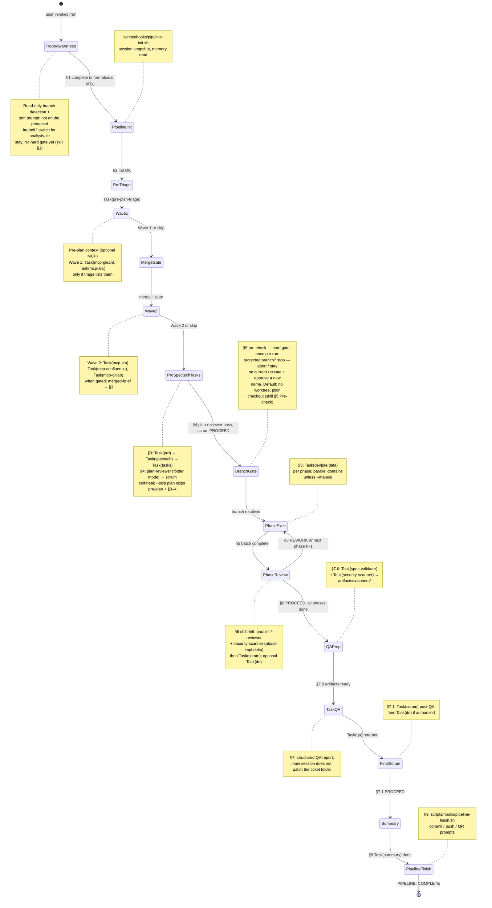
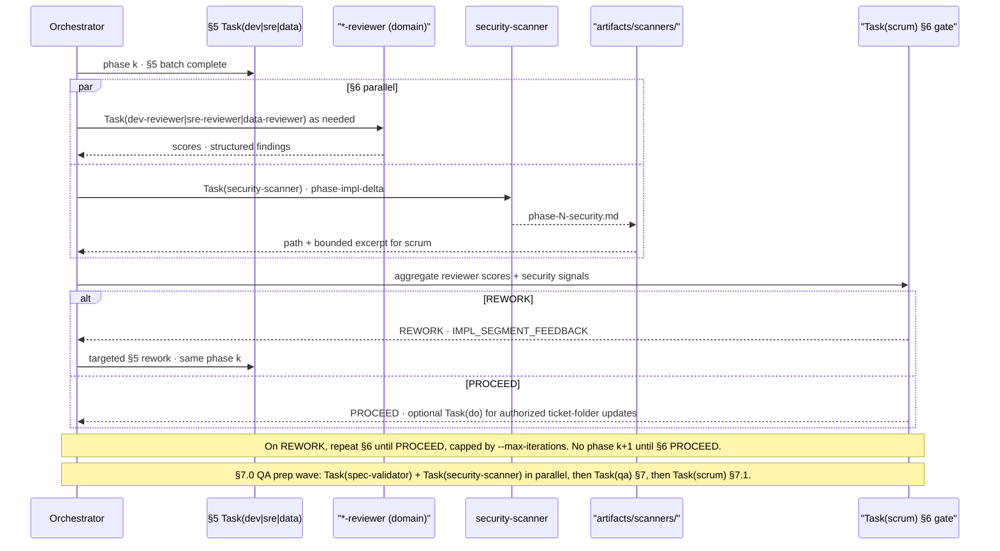

# Agentic Workspace

## Vision and value

The **Agentic Workspace** is a command center for teams that want **spec-aligned delivery** without the failure modes of ad-hoc multi-agent sprawl: runaway context, duplicated work, and nobody sure what shipped. You get a **repeatable pipeline** — PRD → technical spec → tasks → implement → review → QA → summary — with human gates, reviewer scores, and bounded session outputs so work stays **traceable, reviewable, and economical on tokens**.

Two ideas sit on top of each other:

- **SDD** (Spec-Driven Development) makes **specs** authoritative: scope, architecture, acceptance criteria, and phases live in `prd.md` / `spectech.md` / `tasks.md` inside a **ticket folder** under `docs/specs/`, not only in chat history.
- **GSD** (thin vertical slices) keeps each implementation phase **small and independently testable** — a gate between phases instead of one monolithic "do everything" change.

**Flat orchestration** and **least-privilege slices** exist so the system does not recreate the **infinite delegation loops** common in unconstrained multi-agent setups — where one agent spawns another, which spawns another, until context explodes and accountability vanishes. **Only** the `/run` **main session** schedules `Task(prd|spectech|tasks|dev|sre|data|qa|...)`, readonly specialists, and gates; **personas do not nest `Task` on other personas** (flat orchestration — a hard property of the Claude Code / Cursor agent runtime, not just a convention here). Implementers receive **least-privilege** work: **one phase**, **one domain** (e.g. `dev` vs `sre`), and `WORKTREE_PATHS` when needed — not full merged MCP dumps or whole-session transcripts. Readonly specialists write **bounded** artifacts under `docs/sessions/<id>/`. That structure keeps delegation **finite**, prompts **scoped**, and handoffs **explicit**.

**In one line:** `/run <ticket-folder | JIRA-KEY>` loads **[run-pipeline](agentic/skills/run-pipeline/SKILL.md)**: `/prd` → `/spectech` → `/tasks` → implement → review → QA → summary, with gates and least-privilege artifacts under `docs/sessions/<id>/`.

---

## Table of Contents

- [Vision and value](#vision-and-value)
- [What this is](#what-this-is)
- [Framework source and IDE runtimes](#framework-source-and-ide-runtimes)
- [The ticket folder](#the-ticket-folder)
- [Orchestration hub](#orchestration-hub)
- [Pipeline state machine (`/run`)](#pipeline-state-machine-run)
- [Phase gates and shift-left security](#phase-gates-and-shift-left-security)
- [Session directory anatomy](#session-directory-anatomy)
- [30-second setup](#30-second-setup)
- [Zero-Trust script API](#zero-trust-script-api)
- [Personas and commands](#personas-and-commands)
- [Pipeline flags](#pipeline-flags)
- [Confidence scoring](#confidence-scoring)
- [Security and hooks](#security-and-hooks)
- [Session memory and metrics](#session-memory-and-metrics)
- [MCP configuration](#mcp-configuration)
- [Models](#models)
- [Platform reference docs](#platform-reference-docs)
- [Rules of engagement](#rules-of-engagement)
- [Extending the workspace](#extending-the-workspace)

---

## What this is

The workspace is a **spec-driven pipeline**: personas (`/prd`, `/spectech`, `/tasks`, `/dev`, `/sre`, `/data`, `/qa`, `/scrum`, `/summary`, …) and **readonly specialists** (explorers, validators, MCP helpers) coordinated by the **main agent** on `/run`. Escape hatches: `/fix`, `/do` for bugs and ad-hoc ops outside the main pipeline.

Procedure: [run-pipeline skill](agentic/skills/run-pipeline/SKILL.md) · [human-oriented reference](docs/run-pipeline-reference.md) (being refreshed to match the skill — the skill is authoritative) · [CLAUDE.md](CLAUDE.md) (Claude Code) · [00-workspace-router.mdc](.cursor/rules/00-workspace-router.mdc) (Cursor).

---

## Framework source and IDE runtimes

The SDD framework (agents, skills, commands, hooks) has **one canonical source**: `agentic/`. It is **installed** into whichever IDE runtime(s) you use — nothing under `.claude/` or `.cursor/` that came from `agentic/` should be hand-edited; edit the source and reinstall.

```bash
scripts/setup-agentic.sh claude   # → user-level Claude plugin `bcs-sdd` (/bcs-sdd:<name>) + root CLAUDE.md
scripts/setup-agentic.sh cursor   # → .cursor/{agents,hooks,hooks.json,rules,skills}
scripts/setup-agentic.sh all      # claude + cursor (+ antigravity stub)
```

| Layer | Canonical source | Claude Code | Cursor |
|---|---|---|---|
| Personas / subagents | `agentic/agents/` | `bcs-sdd` plugin subagents (Task tool) | `.cursor/agents/` |
| Commands | `agentic/commands/` | `/bcs-sdd:<name>` slash commands | — (Cursor does not mirror commands as skills) |
| Skills | `agentic/skills/` | `bcs-sdd` plugin skills | `.cursor/skills/` |
| Hooks | `agentic/hooks/` + `agentic/adapters/<ide>/hooks/` | `bcs-sdd` plugin `hooks/hooks.json` | `.cursor/hooks.json` + `.cursor/hooks/` |
| **Shared SDD contract** | `agentic/AGENTS.md` | root `AGENTS.md` (generated; imported via `@AGENTS.md` in `CLAUDE.md`) | root `AGENTS.md` (generated; read natively) |
| Always-on identity (IDE-specific wiring only) | `agentic/adapters/claude/CLAUDE.md` | root `CLAUDE.md` (generated — do not edit) | — |
| Always-on identity (IDE-specific wiring only) | `agentic/adapters/cursor/rules/00-workspace-router.mdc` | — | `.cursor/rules/00-workspace-router.mdc` (generated) |

**`agentic/AGENTS.md`** is the single normative source for workspace identity, the ticket-folder
contract, personas, the `/run` pipeline, confidence scoring, multi-repo rules, and the error
protocol — written once, read by both IDEs, so it can't drift between a Claude-flavored and a
Cursor-flavored copy of the same rules. `CLAUDE.md` and `00-workspace-router.mdc` now hold **only**
what genuinely differs per tool: exact invocation mechanics, model-selection tables, and hook
event/matcher names.

**Project overlays** (`bcs-*`, optional, team- or repo-specific) live outside `agentic/` in the IDE runtime dirs (`.claude/`, `.cursor/`, or the shared `.agents/` tree that both read from) and are **never required** by the core SDD personas or the `/run` orchestrator. Full setup details: [agentic/docs/setup.md](agentic/docs/setup.md).

---

## The ticket folder

Every unit of work — a support ticket or a feature — lives in **one folder**:

```
docs/specs/{YYYY-MM-DD}-{TICKET-KEY}-{slug}/      # with a Jira key, e.g. BG-10965
docs/specs/{YYYY-MM-DD}-{slug}/                   # without a ticket key
├── _state.json      # machine state — the ONLY control file (never context.json)
├── _notes.md        # human/agent running log — decisions + "where to resume"
├── prd.md           # product requirements (/prd)
├── spectech.md       # technical design, profile: lean | standard | full (/spectech)
├── tasks.md          # phased task list derived from prd.md + spectech.md (/tasks)
├── qa-report.md       # QA findings (/qa)
└── summary.md           # post-pipeline handoff narrative (/summary)
```

`prd.md`, `spectech.md`, and `tasks.md` are **three separate, right-sized files — never merged into one `spec.md`**. There is **no `/plan` command and no single-file spec mode** in this repo; the required front end of `/run` is always `/prd` → `/spectech` → `/tasks`. `_state.json` + `_notes.md` is the **only** control-file pair — if a folder ever contains `context.json` too, that is a regression to report, not something to silently resolve. Full schema: the `bcs-ticket-workflow` project skill.

---

## Orchestration hub

Readonly specialists run **only** from the **orchestrator** (flat delegation). They write **bounded** output under `docs/sessions/<id>/pre-plan/` (merged MCP briefs) and `docs/sessions/<id>/artifacts/`. Implementers get **least-privilege** slices — one phase, one domain, `WORKTREE_PATHS` — not full session dumps.

`Task(do)` applies mechanical edits (spec checkboxes, `_state.json`, `_notes.md`) through the **allowlisted script API**, and only **after** `Task(scrum)` authorizes it for that gate. **Finish** runs `pipeline-finish.sh` per the git/GitLab rules in `CLAUDE.md` and run-pipeline **§9**.

**Law of flat orchestration:** nested `Task(...)` from a persona is **forbidden**; only the orchestrator delegates. A persona that needs a helper, an enterprise MCP tool, or a human decision escalates with `REQUEST_MAIN:` / `QUESTION:` / `APPROVAL_NEEDED:` and the main loop decides what runs next.

```mermaid
flowchart TD
    MA(["/run main session<br/>Orchestrator hub"])

    subgraph RO["Readonly specialists — only the orchestrator schedules Task(...)"]
        PT[pre-plan-triage]
        W1["Wave 1: Task(mcp-glean) · Task(mcp-arc)"]
        W2["Wave 2: Task(mcp-jira) · Task(mcp-confluence) · Task(mcp-gitlab)"]
        CE[codebase-explorer]
        SV[spec-validator]
        SS[security-scanner]
        PR["plan-reviewer (folder mode)"]
    end

    subgraph SESS["Bounded paths under docs/sessions/(session-id)/"]
        PP["pre-plan/<br/>merged-brief.md, specialists/…"]
        AR["artifacts/<br/>explorer/, scanners/, diffs/…"]
    end

    subgraph LP["Least-privilege implementers — sliced prompts"]
        FE["Task(prd) · Task(spectech) · Task(tasks)"]
        IMPL["Task(dev|sre|data)<br/>one phase · one domain · WORKTREE_PATHS"]
        QA[Task(qa) · Task(summary) · Task(scrum) gates]
    end

    subgraph ZT["Zero-trust allowlist — no ad-hoc shell"]
        QTP[query-transcript.py]
        PF[pipeline-finish.sh]
    end

    MA -->|delegates| RO
    MA -->|Task| FE
    MA -->|Task slice| IMPL
    MA -->|Task| QA

    PT & W1 & W2 --> PP
    CE & SV & SS & PR --> AR

    MA -->|"Task(do) after scrum PROCEED"| QTP
    MA -->|"Finish — §9"| PF

    style MA fill:#c0392b,color:#fff
```

---

## Pipeline state machine (`/run`)

**§1** repo/branch awareness (read-only; soft "switch for analysis or stay?" prompt — **not** a hard gate) → **§2** `pipeline-init.sh` → **Pre-plan** (optional MCP: Wave 1 Glean/ARC → merge + gate → Wave 2 Jira/Confluence/GitLab) → **§3–4** `Task(prd)` → `Task(spectech)` → `Task(tasks)`, then `plan-reviewer` (folder mode) ↔ `Task(scrum)` self-heal loop → **§5 pre-check** (hard branch gate: protected branch? stop — abort / stay / create + approve a name; default **no worktree**, plain checkout) → **§5** per-phase implementation (`Task(dev|sre|data)`) → **§6** implementation review (`*-reviewer` + `security-scanner` → `Task(scrum)`; repeat per phase or on REWORK) → **§7.0** QA prep (`spec-validator` + `security-scanner`) → **§7** `Task(qa)` → **§7.1** final `Task(scrum)` → **§8** `Task(summary)` → **§9** `pipeline-finish.sh` (commit / push / MR prompts).

**Why the branch gate sits at §5, not §1:** `/prd` → `/spectech` → `/tasks` only write the ticket folder (`docs/specs/<ticket>/…`, gitignored) — there's no risk in drafting the spec while the working repo is on its protected/default branch, and that's often the *correct* branch to analyze from. The first actual write to the working repo is §5, so that's where the hard gate (and branch-name approval) belongs. Worktrees are **opt-in only** — the default is a single checkout on whichever branch the §5 gate resolves.

| Kind | Meaning |
|---|---|
| **Human** | Branch consent, manual gates (`--manual`), Finish commit/push/MR choices |
| **Automated** | Hooks and orchestrator paths without extra confirmation |



---

## Phase gates and shift-left security

**§6** (per phase, after **§5**) runs `Task(*-reviewer)` and `Task(security-scanner)` in **parallel** — scanner scoped to `phase-impl-delta`, report at `artifacts/scanners/phase-<N>-security.md` — then `Task(scrum)` aggregates scores and security into one gate. **Critical/High findings force REWORK.** **§7.0** runs a separate **QA prep wave** (`Task(spec-validator)` + `Task(security-scanner)` → `artifacts/scanners/`) before `Task(qa)` (**§7**) and the final `Task(scrum)` (**§7.1**) — still **PROCEED / REWORK / ASK_USER / ESCALATE**. See the [run-pipeline skill](agentic/skills/run-pipeline/SKILL.md) **§6–§7.1**.



---

## Session directory anatomy

**Active session pointer:** `docs/sessions/ACTIVE_SESSION` is a **plain-text file** (one line: the session id). Scripts resolve `docs/sessions/<session-id>/current.md` from that id.

```text
docs/sessions/
├── ACTIVE_SESSION             # one line: active session id (plain file, not a symlink)
└── <session-id>/
    ├── current.md             # timeline, GATE lines, trace anchors
    ├── context-audit.log      # Finish audit (append-only)
    ├── attach-target.txt      # optional: multi-root writable repo root
    ├── session.code-workspace # optional: generated multi-root workspace
    ├── pre-plan/
    │   ├── merged-brief.md
    │   └── specialists/       # glean, arc, jira, confluence, gitlab + mid-run files
    └── artifacts/
        ├── explorer/          # Task(codebase-explorer) reports
        ├── scanners/          # §7.0 spec-validator, security-scanner
        └── diffs/
            ├── dev/
            ├── sre/
            └── data/
```

`docs/sessions/` is **gitignored** — local scratch per clone. No backward-compatibility symlinks are created when artifact paths move (hard cutover to canonical paths only).

---

## 30-second setup

```bash
git clone <repo-url> && cd beacon
scripts/setup-agentic.sh claude   # or: cursor | all
```

- **Prerequisites:** Node.js ≥ 18, git, and the IDE(s) you use (Claude Code and/or Cursor).
- **Target repos:** clone the app repo(s) you'll modify as subdirectories of the workspace root (gitignored, per-developer) — or use multi-root attach (`scripts/tools/attach-project.sh`) for a separate `PROJECTS_ROOT`.
- **Optional MCP:** see [MCP configuration](#mcp-configuration) below.
- Re-run `scripts/setup-agentic.sh <claude|cursor|all>` any time `agentic/` changes — generated trees are overwritten, never hand-edited.

Full guide: [agentic/docs/setup.md](agentic/docs/setup.md).

---

## Zero-Trust script API

Orchestration and `Task(do)` call **allowlisted** scripts only — not raw arbitrary shell or `python3 -c` one-liners for mechanical work.

| Safe entry | Path | Role |
|---|---|---|
| Pipeline init | `scripts/hooks/pipeline-init.sh` | Session wiring at `/run` init (§2). |
| Pipeline commit | `scripts/hooks/pipeline-commit.sh` | Mid-pipeline commit when `_state.json.commit_policy` authorizes it. Never pushes. |
| Pipeline finish | `scripts/hooks/pipeline-finish.sh` | Finish flow: commit, push/MR prompts, session trace audit (§9). |
| Transcript query | `scripts/tools/query-transcript.py` | Read-only transcript slices for `Task(do)` — no hand-rolled JSONL parsing in chat. |

**Why raw shell and inline Python are banned for agents:** only these paths (and the repo's other vetted `scripts/` helpers) are maintained, testable, and lintable. If no script fits, the agent escalates (`QUESTION:`) rather than inventing inline code.

---

## Personas and commands

| Command | Role | Subagent |
|---|---|---|
| `/run` | **Orchestrator** — main session follows [run-pipeline](agentic/skills/run-pipeline/SKILL.md); only this session schedules `Task(...)`. | — (main loop + skill) |
| `/prd` | Product requirements analyzer — `prd.md`. | `prd` |
| `/spectech` | Technical spec designer — `spectech.md` (profile lean/standard/full). | `spectech` |
| `/tasks` | Task breakdown specialist — `tasks.md`. | `tasks` |
| `/dev` | Software engineer — `[dev]` tasks; one phase · one domain per delegation when orchestrated. | `dev` |
| `/sre` | SRE / platform engineer — `[sre]` tasks (IaC, CI/CD, Helm). | `sre` |
| `/data` | Data / ML engineer — `[data]` tasks (pipelines, migrations). | `data` |
| `/qa` | QA and security lead — cross-domain review report; blocks on Critical/High. | `qa` |
| `/scrum` | PO / SM / PM gate — PROCEED / REWORK / ASK_USER / ESCALATE at every gate. | `scrum` (read-only) |
| `/summary` | Post-pipeline handoff narrative — `summary.md`. | `summary` |
| `/kb` | Local knowledge-base builder (fallback when ARC MCP isn't onboarded). | `kb` |
| `/fix` | **Escape hatch** — debugger for a target dir + symptom, outside the full pipeline. | `fix` |
| `/do` | **Escape hatch** — ad-hoc operator; mechanical work via the Zero-Trust script API. | `do` |
| `/clone` | Utility — register a child repo in the multi-repo inventory. | — (thin command) |
| `/rebase` | Utility — multi-repo git-sync with safety backup branch. | — (thin command) |
| `/kb-refresh`, `/kb-concentrator` | Utilities — incremental / cross-repo knowledge-base refresh. | — (thin commands) |
| `/setup-workspace` | Utility — MCP tool registry probe + `docs/workspace-tools.md`. | — (main loop + skill) |
| *Readonly specialists* | `codebase-explorer`, `spec-validator`, `security-scanner`, `plan-reviewer`, `*-reviewer`, `pre-plan-triage`, `mcp-*` — scheduled **only** by the `/run` main session; personas never nest `Task` on these. | — |

Utilities (`/clone`, `/rebase`, `/kb-refresh`, `/kb-concentrator`, `/setup-workspace`) share the workspace but are **not** steps of `/run`.

---

## Pipeline flags

[run-pipeline skill](agentic/skills/run-pipeline/SKILL.md) defines the branch gate (hard consent at §5, right before implementation — not at session start), the opt-in-only worktree, and every flag below.

| Flag | Purpose |
|---|---|
| `--skip plan\|impl-review\|qa\|summary` | Skip a named segment (`plan` = the whole PRD/Spectech/Tasks + pre-plan segment) |
| `--manual` | **Manual step gates** — pause after the plan segment and after each domain track (Proceed / Force review / Add context and review). Independent of per-step model assignment. |
| `--review` | Optional checkpoints after individual steps — orthogonal to `--manual` |
| `--confidence N` | Override the default pass threshold (default 75) |
| `--resume` | Continue from the last `GATE:` / `FAILURE:` in session memory |
| `--branch [name]` | Suggests a branch name — you still approve creation on protected branches |
| `--max-iterations N` | Cap implementation/review rework loops (default 3) |
| `--max-plan-iterations N` | Cap the PRD/Spectech/Tasks ↔ plan-reviewer self-heal loop (default 3) |

---

## Confidence scoring

Reviewers emit 0–100% scores; `/scrum` decides with business judgment at every gate (plan segment, per-phase implementation, post-QA):

- **≥ 75% (default)** → PROCEED
- **50–74%** → ASK_USER
- **< 50%** → REWORK (automatic)
- **Max loops hit** → ESCALATE

`/scrum` may override the default threshold when business context warrants it (document the override). Details: [confidence-scoring skill](agentic/skills/confidence-scoring/SKILL.md).

---

## Security and hooks

Hooks **fail open** except the Cursor `subagent-gate` hook (no writes on protected branches in child repos — no override). `/sre` follows the [deploy-checklist skill](agentic/skills/deploy-checklist/SKILL.md) (5-tier CI/CD coverage: dev/qa/int/sbx/prd). See [cursor-hooks](docs/reference/cursor-hooks.md) and `CLAUDE.md` → **Hooks**.

---

## Session memory and metrics

```bash
scripts/tools/session-memory.sh read
scripts/tools/metrics.sh overview
```

Local-only; aggregates `docs/audit.log`, `docs/sessions/`, and optional `docs/usage-events.tsv`. Nothing leaves the machine.

---

## MCP configuration

- **Claude Code:** project-level `.mcp.json` is the shared, optional baseline (teams add/remove entries; empty by default — MCP is never required for the core flow).
- **Cursor:** personal `~/.cursor/mcp.json` (or project `.cursor/mcp.json`) — see [cursor-mcp](docs/reference/cursor-mcp.md). GitLab MCP is typically stdio `@zereight/mcp-gitlab` — see [gitlab-cursor-workflow](docs/reference/gitlab-cursor-workflow.md).
- Enterprise MCP access (GitLab, Atlassian, Glean, ARC) is **mediated** through the readonly `mcp-*` specialist subagents, scheduled only by the `/run` main session. Persona subagents never call enterprise MCP tools directly — they escalate with `REQUEST_MAIN: <specialist> <query>`.
- Other integrations: [glean-cursor-workflow](docs/reference/glean-cursor-workflow.md), [ARC](docs/reference/arc-mcp-workflow.md).

---

## Models

Every agent's canonical frontmatter is **`model: inherit`** — no hardcoded economy tier, since
available model tiers vary per environment (home vs. work, which IDE, which plan).

**Per-install override (optional, one file per adapter):** copy `agentic/models/example.yml` to
`agentic/models/claude.yml` and/or `agentic/models/cursor.yml` (both gitignored) and list
`<agent>: <model>` for whichever agents you want on a different tier. `scripts/setup-agentic.sh
<claude|cursor>` rewrites that adapter's **installed** copy's `model:` line for listed agents at
install time — the canonical source is never touched, and each adapter only ever reads its own
file, so the same checkout can carry different overrides for Claude Code vs. Cursor (e.g. you use
both at the same job but have different tiers available in each). Re-run setup for that adapter
after editing its file.

**Cursor only, additionally:** a **dynamic** per-step override on top of that, via
`.cursor/models.yml` (team baseline) or `.cursor/models.user.yml` (`use_manual_models: true`),
applied at runtime by `scripts/tools/apply-models.sh` during `/run`. Neither file is tracked by
default. See [model-catalog](docs/model-catalog.md).

---

## Platform reference docs

| Doc | Topic |
|---|---|
| [cursor-agents](docs/reference/cursor-agents.md) | Agents, Task tool, nested-chain caveats |
| [cursor-hooks](docs/reference/cursor-hooks.md) | Hook schemas |
| [cursor-rules](docs/reference/cursor-rules.md) | Rules, AGENTS.md |
| [cursor-skills](docs/reference/cursor-skills.md) | SKILL.md format |
| [cursor-plugins](docs/reference/cursor-plugins.md) | Plugins |
| [cursor-mcp](docs/reference/cursor-mcp.md) | MCP transports |
| [nested-task-audit](docs/reference/nested-task-audit.md) | Flat-orchestration audit, per-agent remediation |

---

## Rules of engagement

1. Pass a **ticket-folder path** or **Jira key** to `/run` (or a target directory to `/fix` / `/do`).
2. **Ticket folder first** for planned work — `/prd` → `/spectech` → `/tasks` before implementation, except `/fix` / `/do`.
3. Analysis (`/prd` → `/spectech` → `/tasks`) is fine on the protected branch — it only writes the ticket folder. Before implementation (§5), use a **feature branch**; protected branches require explicit branch-name approval at that point, and the default is a plain checkout (no worktree) unless you ask for isolation.
4. **MCP is optional** — every persona works with local tools only.
5. **Amend the ticket folder** when scope grows — re-run `/prd` (or `/spectech`/`/tasks`) over the existing folder with "changes," rather than starting a new one.
6. Prefer **linked skills and reference docs** over duplicating procedure here.

---

## Extending the workspace

Add agents under `agentic/agents/`, skills under `agentic/skills/`, commands under `agentic/commands/`, hooks under `agentic/hooks/` (or the per-IDE `agentic/adapters/<ide>/hooks/`) — then reinstall with `scripts/setup-agentic.sh <claude|cursor|all>`. Project-specific overlays that should **not** become part of the shared framework stay directly in the IDE runtime dirs. See [CONTRIBUTING.md](CONTRIBUTING.md) and `scripts/upgrade.sh`.

---

*Spec-driven. Self-healing. Token-efficient.*
